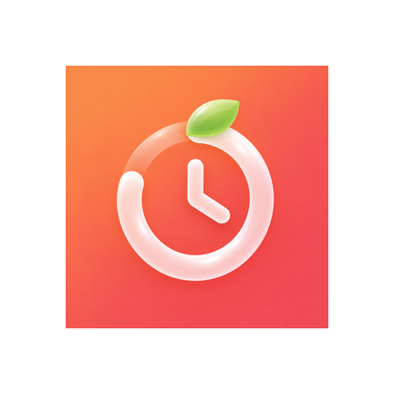
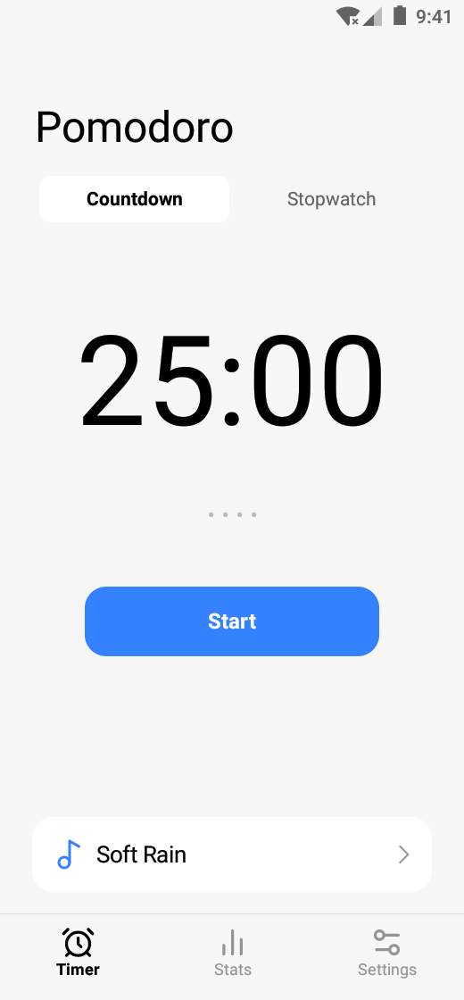
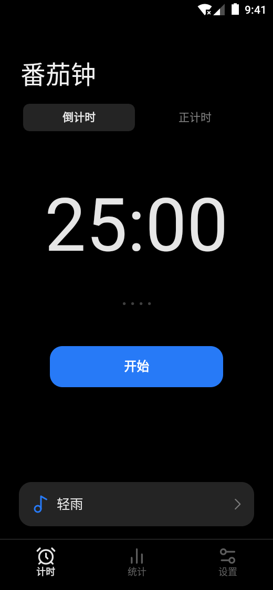
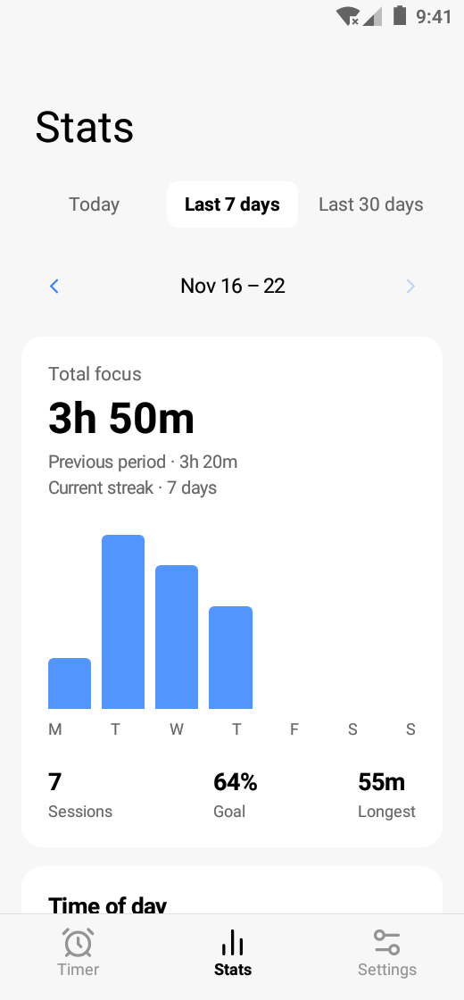
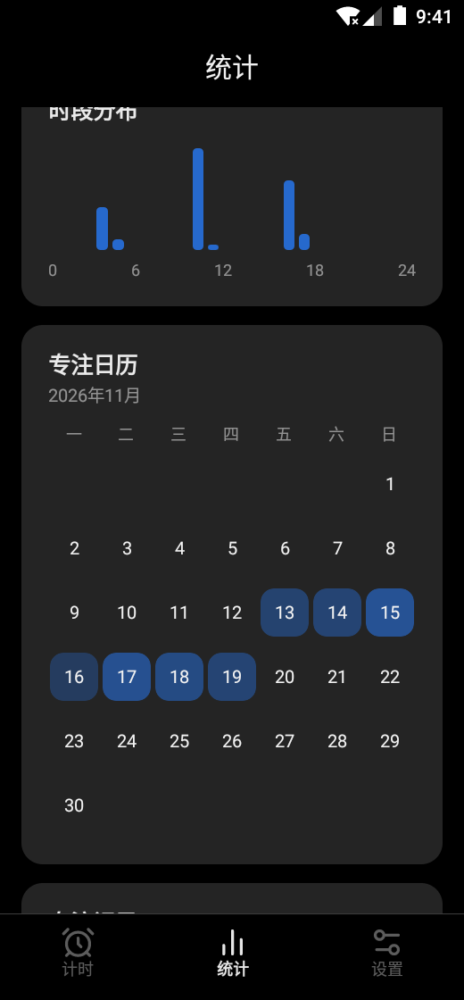
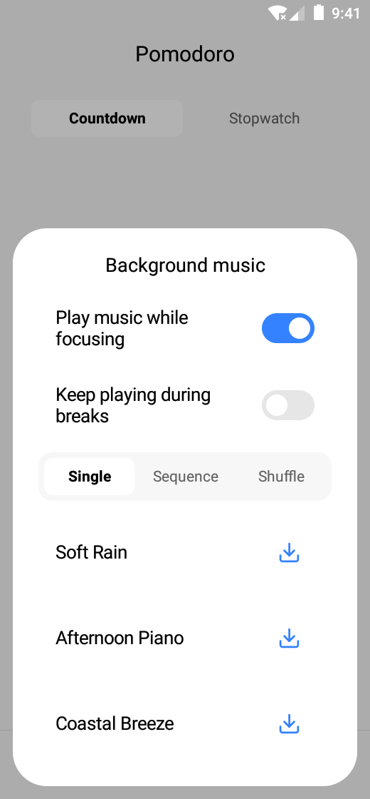
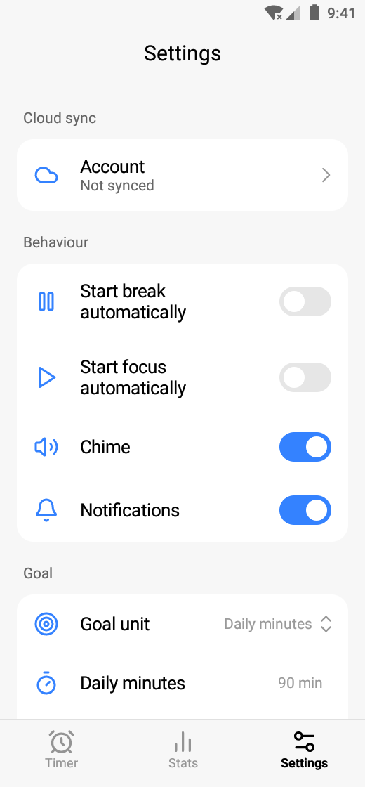

<p align="center">
  
</p>

<h1 align="center">Pomodoro</h1>

<p align="center">A native Android focus timer with a quiet interface and room to make it your own.</p>

<p align="center">
  <strong>English</strong> · <a href="README.zh-CN.md">简体中文</a> · <a href="#build-for-android">Build for Android</a>
</p>

Pomodoro is built with **Kotlin**, **Jetpack Compose**, and **Miuix**. You can start a timer and keep a focus history on your device without creating an account. The app supports English and Simplified Chinese, light and dark themes, and phone and tablet layouts.

## Focus at your own pace

Choose a countdown for a planned session or a stopwatch when you want to keep going. Set the lengths of focus sessions and short and long breaks, or let the next phase start automatically. During focus, an optional blocklist or allowlist can return you to Pomodoro when you open a restricted app. App limits require Android accessibility access.

<p align="center">
  <a href="docs/screenshots/android/timer.png"></a>
  &nbsp;
  <a href="docs/screenshots/android/timer-zh-dark.png"></a>
</p>

<p align="center"><sub>Screenshots from Android v1.0.10 (Miuix). Focus history and music titles use sample data.</sub></p>

## See where your time went

Review your focus time by day, week, or month. The charts show how much time you spent and when, while the focus calendar lets you find records for a specific date. Set a goal in minutes or sessions and manage individual entries in your history.

<p align="center">
  <a href="docs/screenshots/android/statistics.png"></a>
  &nbsp;
  <a href="docs/screenshots/android/calendar.png"></a>
</p>

## Make it your workspace

Open background music from the timer screen. Download individual tracks from a configured cloud library, then play them offline in repeat-one, sequential, or shuffle mode. Optional cloud sync lets you follow an active timer on another device and take it over from its current position.

<p align="center">
  <a href="docs/screenshots/android/music.png"></a>
  &nbsp;
  <a href="docs/screenshots/android/settings.png"></a>
</p>

## Install and update

Download the signed arm64 APK from [GitHub Releases](https://github.com/serotonin0228/pomodoro/releases/latest). Starting with v1.0.11, the app checks for stable updates on launch and can download the APK in-app. Android asks for permission to install from this source the first time and confirms each installation.

## Build for Android

The current app lives in [`android/`](android/). Building it requires **JDK 21**, **Gradle 9.5**, and **Android SDK Platform 37**. The minimum supported device version is Android 8.0 (API 26).

```bash
cd android
gradle :app:assembleDebug
gradle :app:testDebugUnitTest
```

For setup, build signing, and optional Supabase configuration, see the [Android build guide](android/README.md). The earlier React Native and Expo implementation remains in the repository for reference.

Contributions are welcome. See the [contribution guide](CONTRIBUTING.md) and [MIT license](LICENSE).
