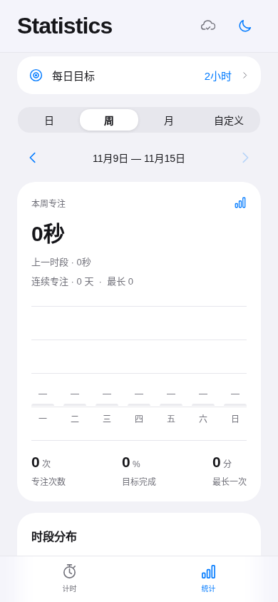
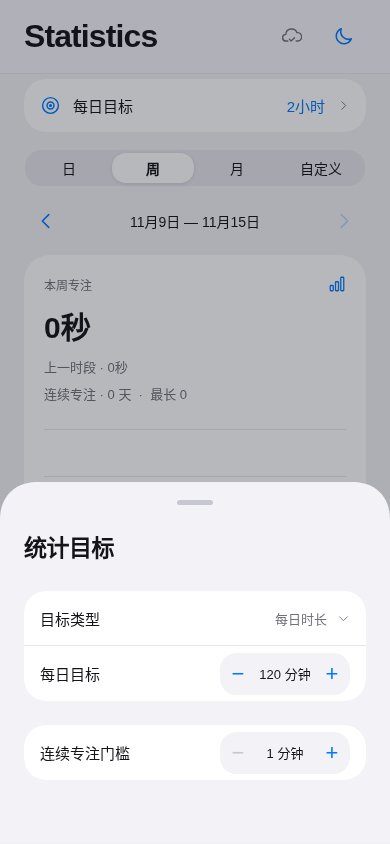

<p align="center">
  
</p>

<h1 align="center">Pomodoro</h1>

<p align="center">
  A focused, minimal timer for everyday work and study.
</p>

<p align="center">
  <a href="README.zh-CN.md">简体中文</a> ·
  <a href="#getting-started">Getting started</a> ·
  <a href="CONTRIBUTING.md">Contributing</a> ·
  <a href="LICENSE">MIT license</a>
</p>

---

Pomodoro is a cross-platform focus timer built with **React Native**, **Expo**, and **TypeScript**. It combines configurable focus sessions, a distraction-free interface, activity insights, and optional cloud synchronization. The timer and local history work without an account.

## Screenshots

Screenshots are from the web version at a phone-sized viewport.

| Timer | Statistics | Goals |
|:---:|:---:|:---:|
|  |  |  |

## Features

- **Flexible sessions** — Count down or count up; pause, resume, save, or discard a session. Configure focus time, short and long breaks, and automatic cycles.
- **Focus insights** — Browse daily, weekly, and monthly activity, set a daily target, review your session history, and export records as CSV.
- **Ambient audio** — Play bundled, looping piano tracks independently of the timer.
- **Personalized appearance** — Light and dark themes, English and Simplified Chinese, and layouts for phones and tablets.
- **Local-first storage** — Keep guest sessions on-device using AsyncStorage. An account is not required for core timer features.
- **Optional sync** — Connect your own Supabase project for email authentication, multi-device synchronization, and explicit conflict handling.
- **Platform notifications** — Local completion reminders and an Android foreground timer service with pause/resume controls.

## Getting started

### Requirements

- Node.js **22.13+**
- npm
- For Android builds: Android SDK and a configured Android development environment
- For iOS builds: macOS and Xcode

### Install and run

```bash
git clone https://github.com/serotonin0228/pomodoro.git
cd pomodoro
npm ci
npm run web
```

For the Expo development server, use `npm start`.

### Native development

```bash
# Android
npm run android

# iOS — requires macOS and Xcode
npm run ios
```

Expo generates the native projects from `app.json` and the configuration plugins in `plugins/`. Native functionality requires a development build; a browser preview cannot reproduce Android foreground-service behavior, system notifications, or all platform-specific visual effects.

## Optional cloud synchronization

Cloud features are disabled unless Supabase credentials are configured. Local timer functionality does not depend on Supabase.

1. Create a Supabase project.
2. Run [`supabase/schema.sql`](supabase/schema.sql) in the Supabase SQL Editor to create the workspace table, policies, and RPC functions.
3. Copy `.env.example` to `.env` and set the public project URL and publishable key:
   ```dotenv
   EXPO_PUBLIC_SUPABASE_URL=https://your-project.supabase.co
   EXPO_PUBLIC_SUPABASE_PUBLISHABLE_KEY=your-public-publishable-key
   ```
4. Enable email authentication in Supabase and configure your confirmation email and redirect settings.
5. Restart the application.

The database enables row-level security and optimistic concurrency control. Guest and authenticated workspaces are stored separately; signing in does not automatically merge guest history.

**Security:** Never commit a service-role key, database password, signing credentials, or a populated `.env` file.

## Development

| Command | Description |
| --- | --- |
| `npm start` | Start the Expo development server |
| `npm run web` | Start the web development server |
| `npm run android` | Build and run on Android |
| `npm run ios` | Build and run on iOS |
| `npm run lint` | Run ESLint through Expo |
| `npm run typecheck` | Run TypeScript checks |
| `npm test` | Run model and localization tests |
| `npm run build` | Export the web application |
| `npm run test:e2e` | Run Playwright browser tests |

The end-to-end suite expects the exported web app at `http://127.0.0.1:8081`:

```bash
npm run build
python3 -m http.server 8081 --directory dist
# In a second terminal:
npm run test:e2e
```

Playwright uses `/usr/bin/chromium` by default. Set `PLAYWRIGHT_CHROMIUM_EXECUTABLE` if Chromium is installed elsewhere.

## Project structure

```text
App.tsx              Application shell and interactions
src/                 Timer logic, views, persistence, and localization
plugins/             Expo configuration and Android native integration
assets/              Icons and bundled audio
supabase/            Database schema and verification queries
tests/               Unit and browser tests
scripts/             Development and packaging utilities
```

## Platform notes

- Android provides a foreground timer service and attempts to request Live Updates on supported systems. Status-bar presentation depends on the device, OS, and notification settings.
- iOS uses local completion notifications; Live Activities and Dynamic Island integration are not implemented.
- Background execution, audio behavior, and notification presentation should be verified on physical devices.
- No hosted synchronization service or prebuilt app download is provided by this repository.

## Contributing

Bug reports and pull requests are welcome. See [CONTRIBUTING.md](CONTRIBUTING.md) for local checks and contribution guidelines.

## License

The application source code is available under the [MIT License](LICENSE). The bundled audio has separate CC0 source information in [`assets/audio/CC0-LICENSES.json`](assets/audio/CC0-LICENSES.json). Original Expo template notices are retained in [NOTICE](NOTICE).
