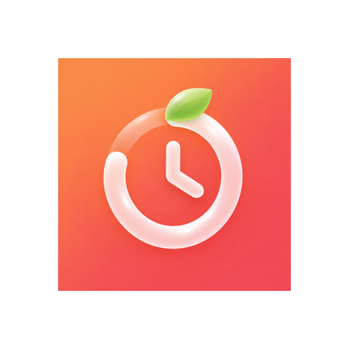

<p align="center">
  
</p>

<h1 align="center">番茄钟</h1>

<p align="center">一款界面简洁、可按自己节奏使用的原生 Android 专注计时器。</p>

<p align="center">
  <a href="README.md">English</a> · <strong>简体中文</strong> · <a href="#构建-android-版">构建 Android 版</a>
</p>

番茄钟基于 **Kotlin**、**Jetpack Compose** 和 **Miuix** 开发。无需注册，就能开始计时并把专注记录保存在本机。应用支持简体中文和英文、浅色和深色主题，以及手机和平板布局。

## 按自己的节奏专注

有明确计划时用倒计时，想继续做下去时用正计时。可以设置专注和长短休息时长，也能让下一阶段自动开始。专注期间，可开启黑名单或白名单，打开受限应用时会返回番茄钟。应用限制需要在 Android 系统中开启辅助功能。

<p align="center">
  <a href="docs/screenshots/android/timer.png"></a>
  &nbsp;
  <a href="docs/screenshots/android/timer-zh-dark.png"></a>
</p>

<p align="center"><sub>以下截图截取自 Android v1.0.10（Miuix），统计与曲目使用示例数据。</sub></p>

## 看看时间都花在了哪里

按日、周、月查看专注时间。图表展示时长和时段分布，专注日历可以定位到某一天的记录。目标可以按分钟或次数设定，历史记录也可以逐条管理。

<p align="center">
  <a href="docs/screenshots/android/statistics.png"></a>
  &nbsp;
  <a href="docs/screenshots/android/calendar.png"></a>
</p>

## 让专注空间适合自己

在计时页打开背景音乐，从已配置的云端曲库按需下载歌曲，离线也能单曲循环、顺序或随机播放。开启云同步后，可以在另一台设备查看正在运行的计时，并从当前进度接管。

<p align="center">
  <a href="docs/screenshots/android/music.png"></a>
  &nbsp;
  <a href="docs/screenshots/android/settings.png"></a>
</p>

## 安装和更新

在 [GitHub Releases](https://github.com/serotonin0228/pomodoro/releases/latest) 下载签名版 arm64 APK。从 v1.0.11 开始，应用启动时会检查正式更新，并可在应用内下载 APK。首次通过番茄钟安装时，Android 会要求允许此来源，每次安装仍需在系统弹窗中确认。

## 构建 Android 版

当前应用源码位于 [`android/`](android/)。构建需要 **JDK 21**、**Gradle 9.5** 和 **Android SDK Platform 37**，最低支持 Android 8.0（API 26）。

```bash
cd android
gradle :app:assembleDebug
gradle :app:testDebugUnitTest
```

环境配置、签名和可选的 Supabase 接入方式见 [Android 构建指南](android/README.md)。早期的 React Native 和 Expo 实现仍保留在仓库中，供参考。

欢迎参与开发。参见[贡献指南](CONTRIBUTING.md)和 [MIT 许可](LICENSE)。
