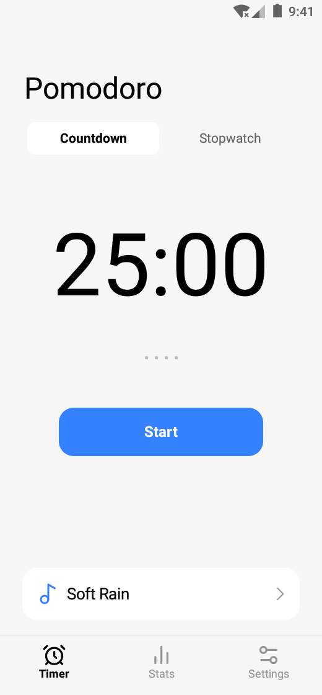
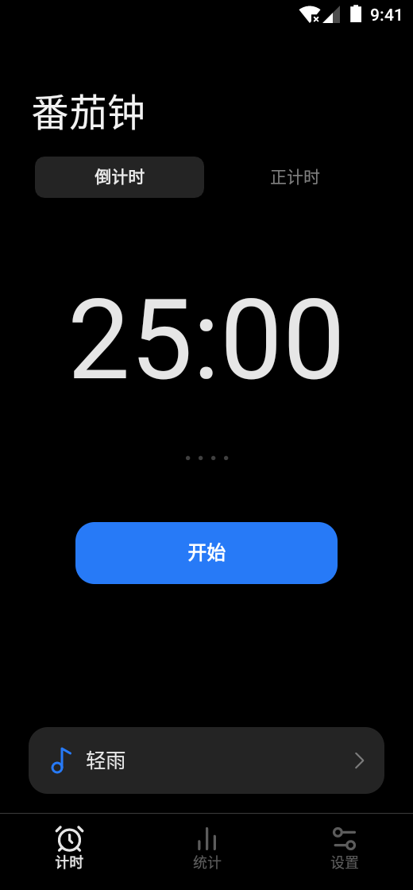
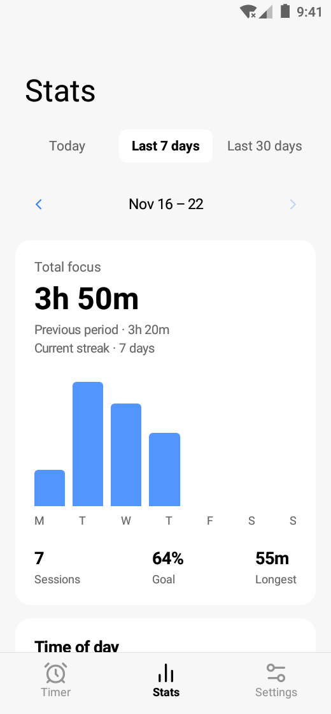
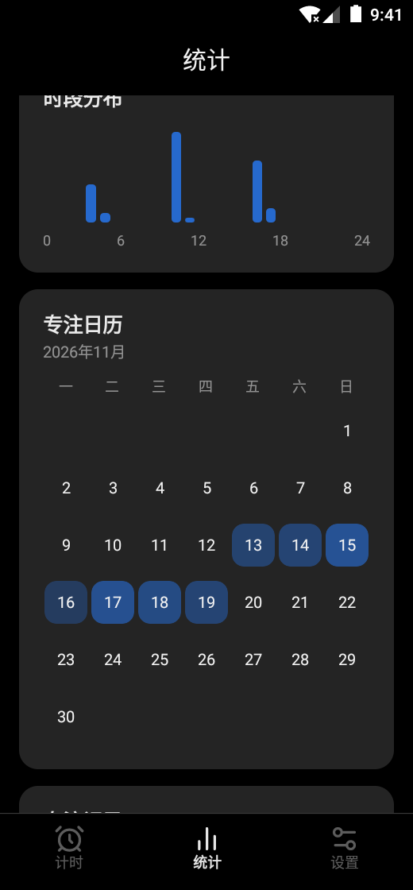
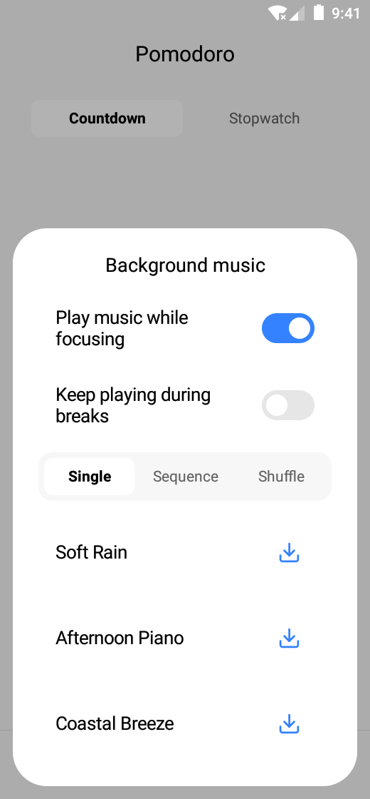
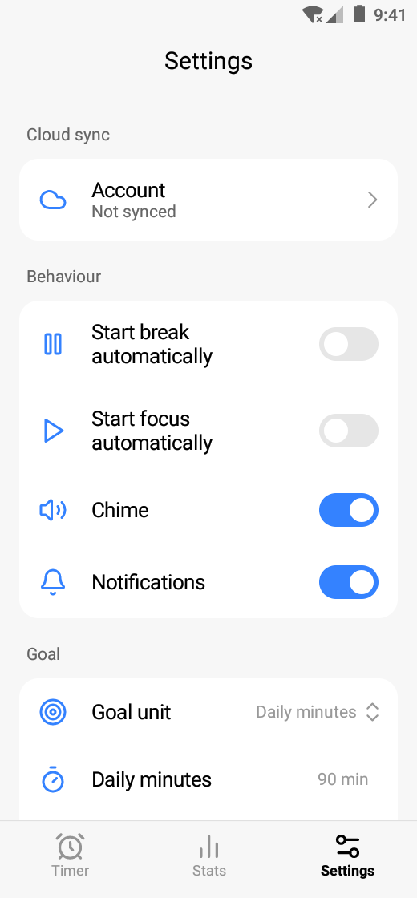

<p align="center">
  
</p>

<h1 align="center">番茄钟</h1>

<p align="center">基于 Kotlin、Jetpack Compose 和 Miuix 的 Android 专注计时器</p>

<p align="center">
  <a href="README.md">English</a> · <strong>简体中文</strong> ·
  <a href="https://github.com/serotonin0228/pomodoro/releases/latest">下载 APK</a> ·
  <a href="supabase/README.zh-CN.md">自建云同步</a>
</p>

## 安装与更新

在 [GitHub Releases](https://github.com/serotonin0228/pomodoro/releases/latest) 下载签名版 **arm64-v8a** APK。支持 Android 8.0（API 26）及以上的 ARM64 手机和平板。首次手动安装时，按 Android 提示允许当前浏览器或文件管理器安装应用。

已有官方版可在 **设置 → 关于 → 检查更新** 下载新版。首次通过番茄钟安装时，Android 会要求允许此安装来源。下载后在系统安装界面确认即可覆盖升级。仓库的 Releases 列表只保留当前正式版。

## 专注计时

- **倒计时与正计时**。可以分别设置专注、短休息、长休息和每轮次数，也可让下一阶段自动开始。
- **后台计时与通知**。支持在通知栏暂停、继续和结束。运行中会更新计时数字，在兼容系统上也会请求 Android 实时活动。小米超级岛等展示由设备和桌面系统决定。
- **应用限制**。可选黑名单或白名单，专注计时运行期间打开受限应用时尝试返回计时页。开启功能后按系统提示授权辅助功能，暂停和休息时可正常使用其他应用。

<p align="center">
  <a href="docs/screenshots/android/timer.png"></a>
  &nbsp;
  <a href="docs/screenshots/android/timer-zh-dark.png"></a>
</p>

<p align="center"><sub>页面示意来自原生 Miuix 版本的早期构建。当前版本的布局以安装包为准，统计与曲目使用示例数据。</sub></p>

## 统计和桌面小组件

- **专注统计**。按日、周、月或自定义日期查看时长、次数、时段分布、连续专注与目标进度。可按日期或计时方式筛选并删除单条专注记录。
- **专注日历**。颜色随一天累计时长连续加深，累计 12 小时到达最深色。点日期可查看当天记录。
- **桌面小组件**。桌面的添加小组件入口提供专注计时、专注日历和专注统计。计时卡支持开始、暂停和继续。统计卡显示今日、本周时长和本周七天柱状图。

<p align="center">
  <a href="docs/screenshots/android/statistics.png"></a>
  &nbsp;
  <a href="docs/screenshots/android/calendar.png"></a>
</p>

## 云同步和背景音乐

日常计时和统计可以直接离线使用。需要同步时，在 **设置 → 云同步 → 账号** 登录，两台设备使用同一邮箱账号即可同步专注记录、工作区设置和计时状态。另一台设备打开计时页，可以查看正在运行的计时并从当前时长接管。

首页可打开背景音乐。配置曲库后，曲目按需下载到本机，支持离线单曲循环、顺序和随机播放。曲目目录随账号同步，各设备独立保存已下载的音频。

官方安装包连接维护者配置的 Supabase。自建时，在自己的 Supabase 项目启用邮箱登录，执行仓库中的同步 SQL，然后把项目 URL 和公开客户端 key 注入 Android 构建。详细步骤覆盖数据库权限、两台设备验证、曲库配置和故障排查。[Supabase 接入指南](supabase/README.zh-CN.md)

<p align="center">
  <a href="docs/screenshots/android/music.png"></a>
  &nbsp;
  <a href="docs/screenshots/android/settings.png"></a>
</p>

## 构建和参与开发

当前 Android 完整源码位于 [`android/`](android/)。需要 JDK 21、Gradle 9.5 和 Android SDK Platform 37。App 支持简体中文和英文，以及浅色和深色模式。

```bash
cd android
gradle :app:assembleDebug :app:testDebugUnitTest :app:lintDebug
```

| 主题 | 文档 |
| --- | --- |
| 编译环境、签名、GitHub Actions 发布 | [Android 构建与发布](android/README.md) |
| 邮箱 Auth、RLS、同步验证、私有曲库 | [Supabase 接入指南](supabase/README.zh-CN.md) |
| 提交贡献与验证改动 | [贡献指南](CONTRIBUTING.md) |
| 许可 | [MIT](LICENSE) |

仓库也保留了早期的 React Native 和 Expo 源码，供历史参考。
