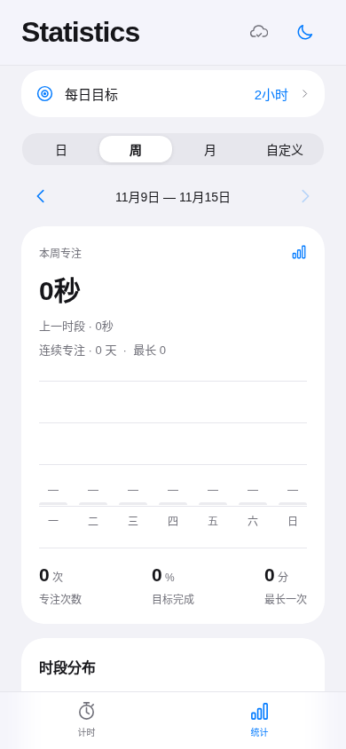
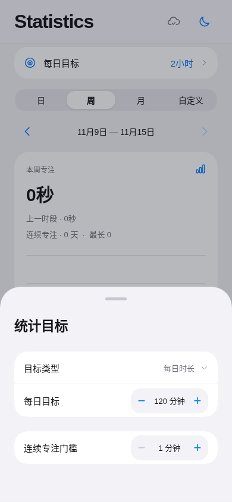

<p align="center">
  
</p>

<h1 align="center">Pomodoro</h1>

<p align="center">
  一款为学习与工作设计的简洁专注计时器。
</p>

<p align="center">
  <a href="README.md">English</a> ·
  <a href="#快速开始">快速开始</a> ·
  <a href="CONTRIBUTING.md">参与贡献</a> ·
  <a href="LICENSE">MIT 许可</a>
</p>

---

Pomodoro 基于 **React Native、Expo 和 TypeScript** 开发，提供可自定义的专注计时、统计分析与可选的跨设备同步。无需注册账号，即可使用计时器和本地专注记录。

## 主要功能

- **灵活计时**：支持倒计时与正计时，以及暂停、继续、保存和丢弃；可调整专注时长、长短休息和自动循环。
- **专注统计**：按日、周、月查看记录，设置每日目标、回顾历史，并可导出 CSV。
- **背景音乐**：从账号云端曲库按需下载，显示下载进度与更新状态；已下载音乐支持离线及原生后台队列播放。曲库管理见 [音乐管理](docs/music-library.md)。
- **外观与语言**：浅色／深色主题，简体中文／英文界面，兼容手机和平板布局。
- **本地优先**：访客数据通过 AsyncStorage 保存在设备上，基本计时功能无需登录。
- **可选云同步**：接入自己的 Supabase 项目后，可通过邮箱登录并在多台设备间同步，支持冲突处理。
- **系统通知**：提供本地到时提醒；Android 支持带暂停／继续操作的前台计时服务。

- **应用限制（Android）**：专注中按黑名单或白名单返回番茄钟，名单仅保存在本机；需手动开启辅助功能权限。暂停、休息、到期时解除限制，电话、桌面及系统设置保留。详见 [实现与限制](docs/app-limits.md)。

## 快速开始

### 环境要求

- Node.js **22.13 或更高版本**
- npm
- Android 构建需要 Android SDK 及相应开发环境
- iOS 构建需要 macOS 和 Xcode

### 安装与运行

```bash
git clone https://github.com/serotonin0228/pomodoro.git
cd pomodoro
npm ci
npm run web
```

运行 Expo 开发服务器可使用 `npm start`。

### 原生应用

```bash
# Android
npm run android

# iOS（需要 macOS 和 Xcode）
npm run ios
```

`app.json` 和 `plugins/` 中的配置用于生成原生工程。原生功能需要开发构建（development build）；浏览器预览无法完整验证 Android 前台服务、系统通知和平台专属的视觉效果。

## 可选：配置云同步

不配置 Supabase 时，计时器与本地记录仍可正常使用。

1. 创建 Supabase 项目。
2. 在 Supabase SQL Editor 执行 [`supabase/schema.sql`](supabase/schema.sql)，创建数据表、访问策略和 RPC 函数。
3. 将 `.env.example` 复制为 `.env`，填入公开的项目地址及 publishable key：
   ```dotenv
   EXPO_PUBLIC_SUPABASE_URL=https://your-project.supabase.co
   EXPO_PUBLIC_SUPABASE_PUBLISHABLE_KEY=your-public-publishable-key
   ```
4. 在 Supabase 中启用邮箱认证，并配置确认邮件与回跳地址。
5. 重启应用。

数据库使用行级安全策略（RLS）和乐观并发控制。访客空间与账号空间相互独立，登录不会自动合并访客记录。

**安全提示：** 请勿提交 service-role key、数据库密码、签名凭据或实际填写的 `.env` 文件。

## 开发与测试

| 命令 | 作用 |
| --- | --- |
| `npm start` | 启动 Expo 开发服务器 |
| `npm run web` | 运行 Web 开发版 |
| `npm run android` | 构建并运行 Android 版本 |
| `npm run ios` | 构建并运行 iOS 版本 |
| `npm run lint` | ESLint 代码检查 |
| `npm run typecheck` | TypeScript 类型检查 |
| `npm test` | 运行计时逻辑和本地化测试 |
| `npm run build` | 导出 Web 应用 |
| `npm run test:e2e` | 执行 Playwright 浏览器测试 |

浏览器端到端测试需要在 `http://127.0.0.1:8081` 启动静态站点：

```bash
npm run build
python3 -m http.server 8081 --directory dist
# 在另一个终端运行
npm run test:e2e
```

Playwright 默认使用 `/usr/bin/chromium`，可通过 `PLAYWRIGHT_CHROMIUM_EXECUTABLE` 指定其他路径。

## 项目结构

```text
App.tsx              应用主界面及交互
src/                 计时逻辑、视图、本地存储与国际化
plugins/             Expo 配置与 Android 原生集成
assets/              图标及内置音频
supabase/            数据库结构与验证脚本
tests/               单元测试及浏览器测试
scripts/             开发与打包工具
```

## 平台说明

- Android 包含前台计时服务，并会在系统支持时请求 Live Updates；状态栏的实际表现取决于设备、系统及通知设置。
- iOS 提供本地到时通知；目前未实现 Live Activities 与灵动岛集成。
- 后台计时、音频播放及系统通知的表现应在真实设备上验证。
- 本仓库不提供托管的同步服务或预编译安装包。

## 参与贡献

欢迎提交问题反馈和 Pull Request。请先阅读 [CONTRIBUTING.md](CONTRIBUTING.md)。

## 开源许可

应用源代码采用 [MIT License](LICENSE)。此个人构建中的四首背景音乐由用户提供，不适用源代码许可；Expo 模板的原始许可声明保留于 [NOTICE](NOTICE)。


## 界面预览

以下截图来自手机尺寸下的网页版本。

| 计时 | 统计 | 目标设置 |
|:---:|:---:|:---:|
|  |  |  |
